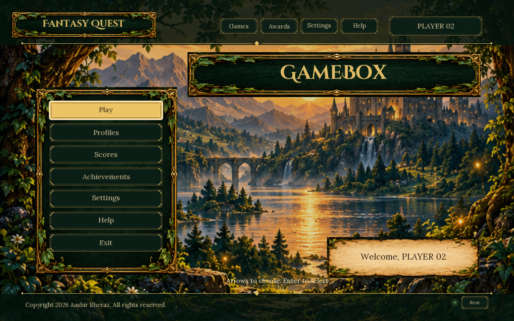
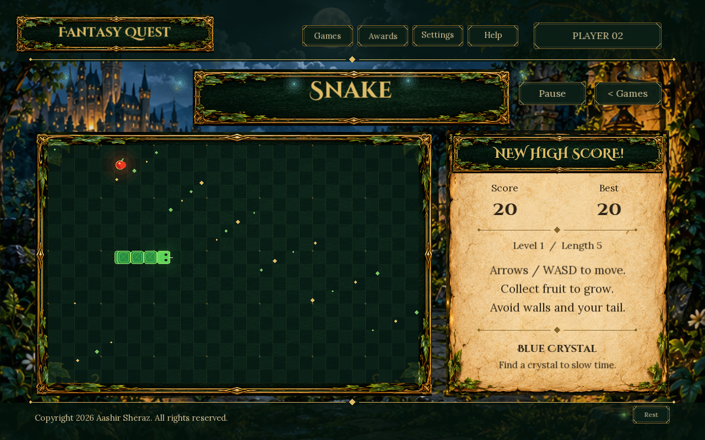
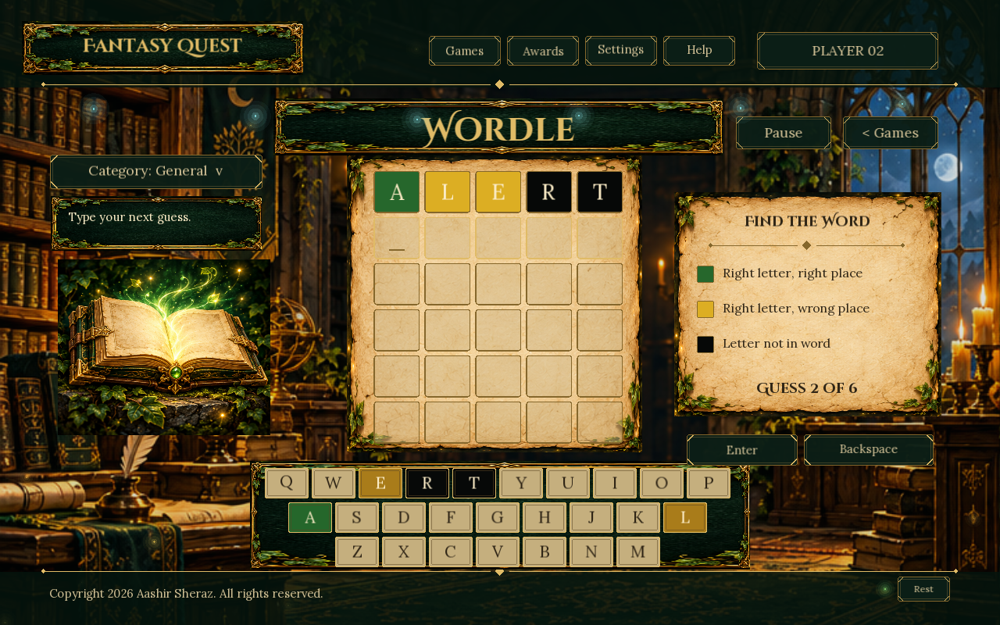
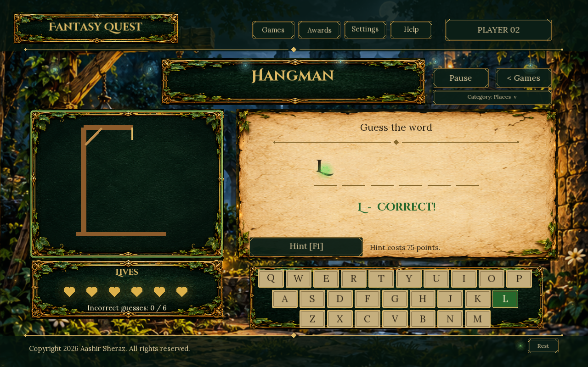

# GameBox: Fantasy Quest

A **C++ OOP project using SFML** with three games: Snake, Wordle and Hangman. It includes player profiles, saved scores, sound, animations and a fantasy-themed menu.

## Screenshots

| Main menu | Snake |
| --- | --- |
|  |  |
| **Wordle** | **Hangman** |
|  |  |

## OOP concepts used

| Concept | How we use it |
| --- | --- |
| **Classes and objects** | Each game, player, menu and sound system has its own class and responsibility. |
| **Encapsulation** | Game data is kept private. Functions control changes to scores, letters, lives and movement. |
| **Inheritance** | SnakeGame, WordleGame and HangmanGame inherit from Game. Player and GuestPlayer inherit from User. |
| **Abstraction** | Game defines common functions such as input, update, draw, save and load. Each game supplies its own implementation. |
| **Polymorphism** | The program uses a Game reference to run the selected game. Virtual functions call that game's own behaviour. |
| **Composition** | GameBoy owns the games, screen, input, menus, sound and animation effects. Each game also owns its smaller components. |
| **Aggregation** | GameCollection holds references through pointers to the three existing games without owning them. |
| **Constructors and destructors** | Constructors prepare objects. Destructors release resources automatically; Game has a virtual destructor. |

We also use **file handling** to save profiles, settings, scores and game progress.

Game storage uses **fixed-size arrays and strings**. There are no linked lists, STL vectors, trees, maps, queues or stacks in the application code.

## How it works

1. The program loads the shared graphics, fonts, sounds and selected player profile.
2. The main menu lets the player choose a game, change settings or view scores and achievements.
3. While playing, the program reads keyboard and mouse input, updates the game, and draws the screen each frame.
4. Timers control movement and animations so the window stays responsive.
5. Scores and progress are saved automatically. Each player profile keeps its own records.

### Snake

Move the snake, eat fruit and avoid walls and your own body. Eating grows the snake and increases the score. Blue crystals temporarily slow it down. A new high score triggers a celebration; a collision plays a one-second blackout and shake before the results appear.

### Wordle

Choose a category and guess a five-letter answer in six attempts. Every complete five-letter guess receives feedback:

- **Green:** correct letter in the correct position.
- **Yellow:** the letter is in the answer, but in another position.
- **Black:** the letter is absent, or that letter's available matches have already been used.

Categories include General, Places, Footballers, Animals, Nature and Fantasy. Wordle keeps five-letter answers in every category.

### Hangman

Choose Creatures, Objects, Nature, Places, Footballers or Animals, then guess letters. Six incorrect guesses end the round. Repeating a letter does not cost another life. Correct and incorrect guesses have different animations. A hint reveals a letter and clue for a score penalty.

## Controls

| Action | Controls |
| --- | --- |
| Choose a menu option | Arrow keys and Enter, or mouse |
| Move the snake | Arrow keys or WASD |
| Submit a Wordle guess | Enter; Backspace edits |
| Guess a Hangman letter | Type or click a letter |
| Choose a word category | Category button, or Tab followed by arrows and Enter |
| Use a Hangman hint | F1 |
| Pause | Escape; P also pauses Snake |
| Open help | F2 |

## Run on Windows

Requirements: **C++17 and SFML 2.6.1**. The setup script downloads a matching compiler and SFML into the project's .tools folder.

```powershell
powershell -ExecutionPolicy Bypass -File scripts/setup.ps1
powershell -ExecutionPolicy Bypass -File scripts/build.ps1 -Run
```

In **VS Code**, choose **Terminal > Run Task > Fantasy Quest: play**. Ctrl+Shift+B builds the project.

To run the tests:

```powershell
powershell -ExecutionPolicy Bypass -File scripts/build.ps1 -Test
```

For audio playback checks, run scripts/test-audio.ps1. This test plays sounds.

To prepare a portable folder, run scripts/package.ps1, then open **dist/FantasyQuest/FantasyQuest.exe**. Keep its assets and DLLs beside it. Local saves are stored in data/; build tools, generated builds and personal saves are excluded from Git.

## Project files

- **src/Model.hpp and Model.cpp:** classes, game rules, scores and saving/loading.
- **src/Frontend.hpp and Frontend.cpp:** drawing helpers, input, display, sound and effect timers.
- **src/GameViews.cpp:** each game's drawing functions.
- **src/Application.cpp:** menus, game switching and the main loop.
- **assets/:** images, fonts, music, effects and their licenses.
- **tests/:** game-rule, application and audio checks.

See the [class diagram](docs/ARCHITECTURE.md), [test record](docs/VERIFICATION.md) and [asset credits](docs/ASSETS.md) for more detail.

Copyright 2026 Aashir Sheraz. All rights reserved. Third-party assets retain their respective licenses.
