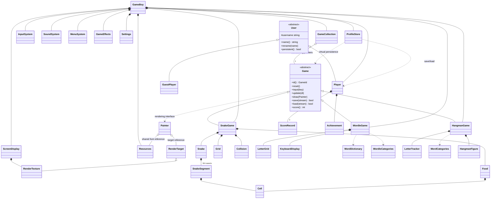

# Architecture and OOP rationale

## Class relationships

`WordCategories` and `WordDictionary` are stateless helpers, so their relationships are dependencies rather than ownership. HangmanGame owns a HangmanFigure, which tracks added parts, enforces the six-part limit, and draws through Painter. RenderTarget and RenderTexture in the diagram are SFML types. Painter borrows the target; ScreenDisplay owns the texture.

## Inheritance and abstraction

1. `Game` declares pure virtual operations that all cartridges must implement. It owns shared score/end-state information. Its virtual destructor makes polymorphic destruction valid even though current game instances use direct ownership.
2. `User` defines common identity and a pure virtual persistence policy. `Player` implements persistent profiles; `GuestPlayer` provides a nonpersistent model example. The current product interface intentionally exposes only persistent player slots.

## Runtime polymorphism

1. The frame loop obtains `Game&` from `GameCollection` and calls `update` and `draw` without a type-specific rendering switch. Game-specific views are their overrides.
2. `ProfileStore` calls virtual `Game::save` and `Game::load` for different cartridge state formats. User persistence policy is also verified through a `User&` in the model tests.

A `switch` chooses which top-level menu page to draw. This is ordinary screen state management, not a substitute for the game's virtual interface.

## Composition

1. GameBoy owns display, sound, input, menu, settings, profile, and three cartridges as direct members.
2. SnakeGame owns board, snake, food, and collision rules. WordleGame owns letter cells and keyboard state. HangmanGame owns its tracker. Player owns score records and achievement state.

Owned components have the same enclosing lifetime. No manual allocation is required.

## Aggregation and shared resources

1. GameCollection contains three non-owning Game pointers referring to cartridge objects owned by GameBoy. The games outlive the collection's use; deleting through those pointers would be incorrect.
2. Painter borrows a render target and shared Resources. All cartridges draw with the same two loaded fonts and shared artwork atlases. The sound service shares a bounded pool of twelve voices across game cues.

Do not call owned achievements aggregation: in this implementation they are composition because Player stores them directly.

## Encapsulation and invariants

- Snake alone changes segment count, direction, and position. A reversal or second pending turn in the same tick is rejected. `previous` is visual interpolation history, not an independently authoritative position.
- At most 504 segments fit a 28 x 18 board. Linear checks are sufficient at this classroom scale.
- Food selection counts free cells, chooses an available-cell index, and scans to it. It cannot enter an infinite random-retry loop when the board fills.
- Entering the vacating tail is allowed when not growing; entering any occupied cell while growing is forbidden.
- Wordle exact matches are counted first; remaining answer-letter counts are consumed for yellow matches. Keyboard state only improves in certainty.
- A letter is tracked once in Hangman; repeated input never costs another life.
- All round-completion side effects are guarded by a per-cartridge recorded flag. Resuming a completed save does not award the same score twice.
- Each game loads into a temporary candidate, validates bounds and content, and replaces the live state only on success.

## Timing, display, and lifecycle

An SFML Clock supplies elapsed seconds. Snake uses a bounded fixed-step accumulator, then interpolates positions for rendering. The frame loop caps unusually large elapsed frames to avoid a sudden burst after a stall. VSync reduces tearing. Page transitions fade, and unfocused active gameplay pauses.

The display owns a 1280 x 800 RenderTexture. Presentation and input use the same scale and offsets, preserving pointer alignment under letterboxing. Standard SFML RenderWindow back-buffer swapping handles final output.

Cartridges are constructed once and retained. Switching suspends updates and preserves state; it does not repeatedly allocate/unload objects. Profile switching reloads separate snapshots. Sleep freezes gameplay and pauses the music. Normal exit saves.

## Persistence design

Profile files contain a format signature, quoted name, three score records, achievement flags, Wordle rate-limit state, and settings. Cartridge files contain a signature, game id, and game-specific validated state. Snake stores body positions/direction, food, active pickup and effect duration, difficulty, and score; interpolation restarts at a coherent position after loading. Wordle stores its answer, submitted guesses, and pending input, and recomputes colors. Hangman stores category, selected word index, hint use, and guessed letters, and recomputes mistakes.

Writes use a temporary file and rename, retaining one backup. This reduces ordinary partial-write damage but is not a transactional database or a guarantee against sudden power loss. Profiles try the backup on read failure. Cooldowns use the local wall clock, so they are not resistant to system-clock tampering.

## Viva prompts

- Why use an abstract Game? To enforce a consistent lifecycle and dispatch cartridge behavior at runtime.
- Why composition for the board? A game has a board; it is not a kind of board.
- Why a pointer array? It refers to pre-existing objects through a common base without taking ownership or resizing.
- Why no destructor with delete? Direct members clean themselves up; SFML resources follow RAII.
- Why fixed arrays? Capacity is known and bounded, meeting the course restriction without linked storage or container classes.
- Why separate rules and views? Rule tests require neither an audio device nor a graphics context; the same verified state drives the SFML rendering.

## Fantasy Quest update

Resources now owns shared environment, panel/illustration and transparent puppet textures alongside Cinzel and Lora fonts. Painter uses source rectangles, nine-slice frames and fixed-size textured vertex geometry to render scalable panels and six progressive puppet parts. InputSystem maps the coordinates stored in SFML pointer events; sliders support dragging and use the same letterbox transform.

SoundSystem owns 27 cached buffers, twelve voices, two alternating scene Music streams and one result stream. Cue is a scoped enumeration. Music crossfades over 0.45 seconds; pause ducks the mix and sleep pauses streams. Wordle cue times follow tile flip midpoints. A completed round is recorded immediately; only its audio/visual celebration is delayed.

The main menu and score chronicle are explicit pages in MenuSystem. Settings persistence version 2 adds master volume and mute while retaining version 1 profile reads. Hangman saves have a new marker because the fantasy categories changed.

## Timed feedback and categories

GameBoy composes GameEffects, which owns bounded animation timers for the one-second Snake impact, high-score celebration and Hangman reactions. ScreenDisplay applies the decaying camera offset. Results wait for the corresponding animation while scores are recorded immediately. A live Snake record is saved before the round finishes. These effects use frame time, preserving event handling and audio throughout the pause.

WordleCategories and WordCategories provide fixed answer arrays. Wordle retains a five-column grid in every category and evaluates every complete alphabetic guess; no dictionary gate prevents colour feedback. Exact matches consume answer letters before yellow matches. Category changes start a new puzzle and preserve other games' progress. Wordle save format 2 records category and accepts old snapshots; Hangman's original category indices remain stable.
